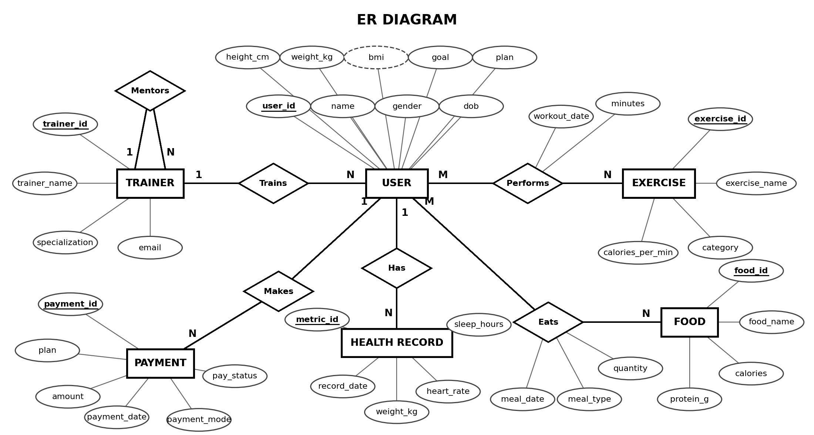

# Fitness & Healthcare Management Database

A relational database project built with **MySQL 8.0** that stores users, trainers,
exercises, workouts, meals, health records and payments of a fitness platform.

## Features

- 8 normalised tables (up to 3NF) with primary keys, foreign keys, CHECK, UNIQUE and DEFAULT constraints
- BMI calculated automatically using triggers and a user defined function
- Weight history saved automatically when a user's weight is updated
- Personalised workout and diet suggestion using a stored procedure
- Cursor based calories report
- Transaction with COMMIT, ROLLBACK and SAVEPOINT
- Role based security using GRANT and REVOKE

## Database Design



| Table | Purpose |
|---|---|
| users | Profile, BMI, goal, plan |
| trainers | Trainers and their mentors |
| exercises | Exercises with calories per minute |
| workouts | Link table: users and exercises |
| food_items | Food calories and protein |
| meal_logs | Link table: users and food |
| health_metrics | Weight, heart rate, sleep |
| payments | Subscription payments |

## MySQL Concepts Used

| Category | Topics |
|---|---|
| DDL | CREATE, ALTER, INDEX |
| DML | INSERT, UPDATE, DELETE |
| Queries | WHERE, ORDER BY, LIKE, IN, BETWEEN, IS NULL, GROUP BY, HAVING |
| Joins | INNER, LEFT, SELF, multi-table |
| Subqueries | Scalar, NOT IN, correlated |
| Objects | 3 views, 2 functions, 4 triggers, 3 stored procedures |
| Control | Cursor, transactions, SAVEPOINT |
| Security | CREATE USER, GRANT, REVOKE, roles |

## How to Run

1. Install MySQL 8.0 and MySQL Workbench
2. Open `fitness_healthcare_db.sql` in Workbench
3. Click the lightning icon to run the full script
4. Try the stored procedure:

```sql
USE fitness_healthcare_db;
CALL recommend_plan(7);
```

## Project Files

| File | Description |
|---|---|
| `fitness_healthcare_db.sql` | Complete MySQL script (tables, data, queries, objects) |
| `ER_Diagram.png` | ER diagram (Chen notation) |
| `Report.docx` | Project report |
| `Presentation.pptx` | Project presentation |

## Author

**[Your Name]**  
[College Name]
